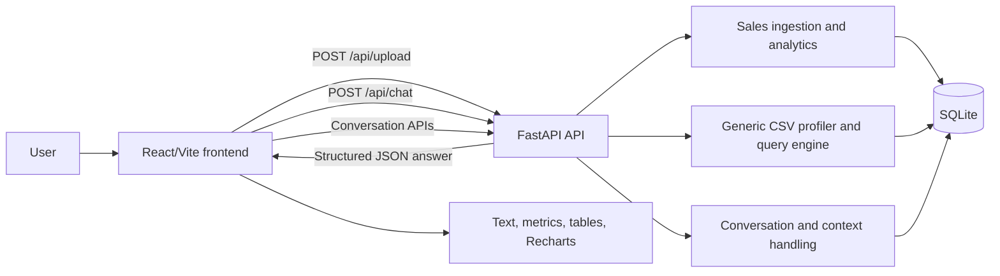

# InsightIQ Architecture

## Overview

InsightIQ is a React/Vite frontend backed by a FastAPI service. The service stores sales transactions, uploaded generic CSV datasets, conversations, messages, profiles, and authentication records in SQLite. Pandas is used for CSV parsing and profiling. Recharts renders chart data returned by the API.

The current question-answering path is deterministic. It maps natural-language questions to allowlisted operations and executes parameterized SQLite queries. The application does not execute arbitrary SQL generated by an external model. `OPENAI_API_KEY` and `OPENAI_MODEL` are configuration placeholders only; no external LLM call is required by the implemented path.

## Responsibilities

### Frontend

- React application in `frontend/src`.
- Authentication screens and token storage.
- CSV upload through `multipart/form-data`.
- Conversation creation, selection, rename, delete, and message rendering.
- Sends questions to `POST /api/chat`.
- Renders answer text, metrics, tables, charts, errors, and dataset metadata.
- Uses local storage for UI preferences such as theme and chat settings.

### Backend

- FastAPI routes in `backend/app/main.py`.
- Validates request payloads with Pydantic models.
- Selects the dataset associated with the conversation, or the active global dataset.
- Persists conversations and messages.
- Returns structured answer responses for the frontend.

### CSV processing

- Sales-shaped CSVs are handled by `backend/app/ingestion.py`.
- Generic CSVs are handled by `backend/app/generic.py`.
- Generic ingestion detects delimiters and encoding, normalizes column names, infers number/date/categorical/text types, counts missing values, detects duplicate rows, and stores the data in a generated SQLite table.
- Invalid, empty, malformed, binary, or unnamed-column files are rejected.

### Query and analytics processing

- Trusted sales analytics are implemented in `backend/app/analytics.py` and `backend/app/services.py`.
- Generic natural-language operations are implemented in `backend/app/generic.py`.
- Supported generic operations include counts, numeric aggregates, filters, grouping, ranking, date/year filtering, comparisons, samples, unique values, missing values, and duplicates.
- Identifiers are validated and quoted; values are passed as SQLite parameters.

### Database

SQLite is initialized in `backend/app/database.py`.

Important tables:

- `transactions`: normalized sales records.
- `rejected_records` and `ingestion_runs`: sales import quality information.
- `generic_datasets`: generic dataset metadata and schema profiles.
- Generated `dataset_<uuid>` tables: generic CSV rows.
- `conversations` and `messages`: chat history and dataset association.
- `users`, `auth_tokens`, and `profiles`: authentication and profile data.
- `app_state`: active dataset state.

## Request and data flow

### CSV upload

1. The user selects a CSV in `App.jsx`.
2. `frontend/src/services/api.js` sends `POST /api/upload`.
3. FastAPI saves the file under the configured data directory.
4. The backend detects whether it matches the trusted sales schema.
5. Sales files are normalized into `transactions`; other files are profiled and stored in a generated dataset table.
6. The active dataset and conversation `dataset_ref` are updated.
7. The frontend displays the returned filename, schema counts, missing values, and duplicate count.

### Question answering

1. The user submits a question from the composer.
2. The frontend creates a conversation if needed and calls `POST /api/chat` with `question` and `conversation_id`.
3. The backend loads the conversation's dataset reference and previous context.
4. The appropriate sales or generic query engine maps the question to a supported operation.
5. The engine executes a read-only, parameterized SQLite query.
6. FastAPI returns answer text plus metrics, table rows, chart data, and an explanation.
7. The frontend appends the assistant response after the user's message.
8. The question, answer, result, and follow-up context are persisted.

## Mermaid diagram

## Deployment boundary

The backend and frontend are separate services in `render.yaml`. SQLite and uploaded CSV files require persistent disk storage in production. The frontend receives the backend URL through `VITE_API_URL`; the backend allows configured frontend origins through `FRONTEND_ORIGINS`.
